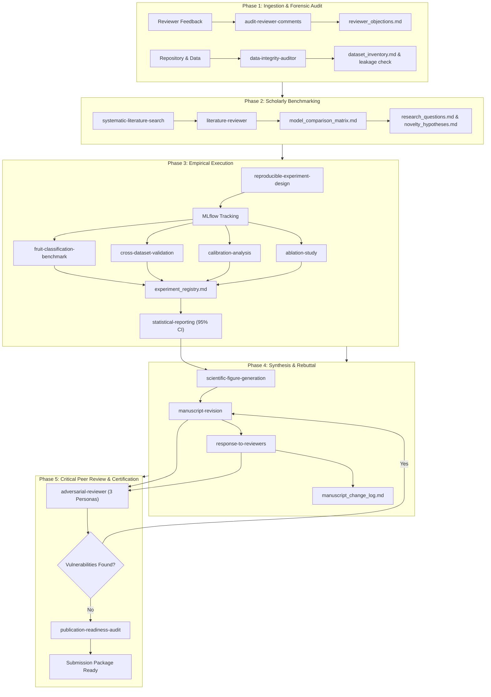

# AgriRoute Research Lab Plugin (`agriroute-research-lab`)

A comprehensive academic research workflow plugin for Google Antigravity, engineered specifically to manage the peer-review revision, empirical auditing, and scientific rigor of the **AgriRoute** post-harvest logistics paper:

> **"AgriRoute: A Vision-Based Post-Harvest Risk System"**

---

## 1. Architectural Overview

```
agriroute-research-lab/
├── plugin.json                    # Plugin manifest (metadata, keywords, prompts)
├── assets/
│   └── logo.svg                   # Plugin vector icon
├── README.md                      # Comprehensive plugin documentation
├── INSTALL.md                     # CLI installation and verification guide
├── rules/
│   └── AGENTS.md                  # 13 permanent scientific integrity & ethics rules
├── agents/                        # 7 Specialized AI Research Agents
│   ├── research-director.md       # Principal investigator & workflow orchestrator
│   ├── literature-reviewer.md     # Scholarly search & SOTA matrix specialist
│   ├── data-integrity-auditor.md  # Leakage, provenance & synthetic artifact auditor
│   ├── computer-vision-researcher.md # Multi-backbone benchmark & Grad-CAM expert
│   ├── statistical-methodologist.md  # Calibration, ECE, CIs & ablation designer
│   ├── manuscript-editor.md       # Paper section rewrites & reviewer rebuttal drafting
│   └── adversarial-reviewer.md    # 3-persona critical peer reviewer simulation
├── skills/                        # 17 Reusable Specialized Skills
│   ├── audit-reviewer-comments/   # Deconstruct reviewer feedback into actionable registry
│   ├── systematic-literature-search/ # Multi-database queries (OpenAlex, Scholar, Scite)
│   ├── research-gap-identification/ # SOTA matrices & authentic novelty bounding
│   ├── citation-verification/     # Crossref / DOI / metadata verification
│   ├── dataset-provenance-audit/  # Checksums, licenses, and raw asset tracing
│   ├── image-leakage-detection/   # pHash & MD5 deduplication across train/test splits
│   ├── reproducible-experiment-design/ # Deterministic seeds, configs, and MLflow logging
│   ├── fruit-classification-benchmark/ # MobileNetV2 vs. EfficientNetB0 vs. ResNet50
│   ├── cross-dataset-validation/  # Out-of-distribution generalization testing
│   ├── calibration-analysis/      # ECE, Brier score, and post-hoc temperature scaling
│   ├── gradcam-analysis/          # Penultimate-layer convolutional attention maps
│   ├── ablation-study/            # Modular feature & fusion weight ablation
│   ├── statistical-reporting/     # 95% bootstrap CIs, McNemar & Wilcoxon tests
│   ├── scientific-figure-generation/ # Elsevier / Procedia-compliant vector figures
│   ├── manuscript-revision/       # Section-by-section academic paper revision
│   ├── response-to-reviewers/     # Point-by-point rebuttal letter with exact line numbers
│   └── publication-readiness-audit/ # Pre-submission sanity checks & ethics disclosures
└── research_memory/               # 9 Persistent Project Records
    ├── reviewer_objections.md     # Atomic reviewer feedback register
    ├── research_questions.md      # Formal research questions (RQ1-RQ4)
    ├── novelty_hypotheses.md      # Delineation of genuine contributions
    ├── dataset_inventory.md       # Checksums, licenses, and sample counts
    ├── experiment_registry.md     # MLflow run tracking manifest
    ├── model_comparison_matrix.md # Backbone benchmarks & literature SOTA table
    ├── claims_evidence_ledger.md  # Source script & output mapping for all paper numbers
    ├── reference_library_index.md # Verified BibTeX citations & DOIs
    └── manuscript_change_log.md   # Chronological paper edit history
```

---

## 2. Research Workflow & Lifecycle

The plugin operates across five interconnected revision phases:



---

## 3. Scientific Integrity Guarantees

All agents and skills are permanently bound by `rules/AGENTS.md`:
1. **Never fabricate a result:** No metric or p-value may be invented.
2. **Never invent a DOI:** Every citation must resolve to an authentic publication.
3. **Never report an unexecuted experiment as complete:** Unfinished runs must be marked `PENDING` or `PLANNED`.
4. **Never change the test set post-evaluation:** The test split remains sealed.
5. **Never claim synthetic data is real-world:** Simulated sensor logs must be explicitly marked `SIMULATED`.
6. **Never equate accuracy with field impact:** Benchmark scores on curated images do not prove supply-chain efficacy.
7. **Never call an uncalibrated score a probability:** Calibration error (ECE) must be reported.
8. **Never overwrite the original submitted paper:** Revisions occur in versioned paths.
9. **Preserve provenance:** Record hashes, licenses, and origins for all datasets.
10. **Maintain reproducible configs:** Random seeds, hardware, and libraries must be logged via MLflow.
11. **Link every number to code:** All quantitative claims must map to `claims_evidence_ledger.md`.

