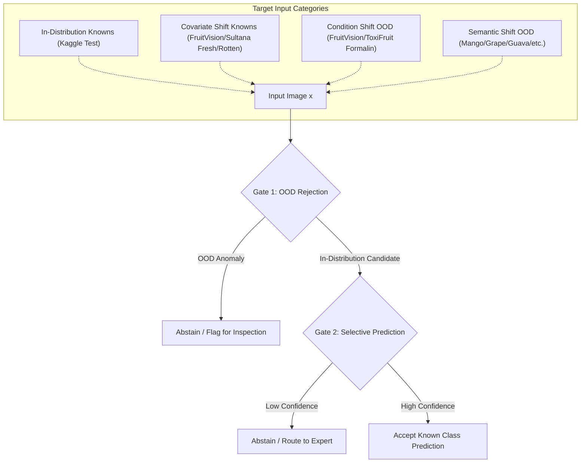

# Dataset Feasibility & Provenance Audit: Multi-Source Open-Set Evaluation

**Role:** Principal Investigator & Lead Data Architect  
**Project:** AgriRoute / Spoilage-Predictor  
**Date:** November 10, 2026  
**Status:** Complete Forensic Feasibility Audit

---

## 1. Comparative Dataset Taxonomy & Metadata

To evaluate open-set recognition and out-of-distribution abstention under realistic agricultural distribution shifts, we audit four benchmark datasets: the primary training dataset (**Kaggle Fresh/Rotten**), and three external evaluation benchmarks (**FruitVision 2025**, **ToxiFruit 2026**, and **Sultana 2022**).

| Dataset Attribute | Kaggle Fresh/Rotten (Primary Training) | FruitVision (Bijoy et al. 2025) | ToxiFruit (Sattar et al. 2026) | Sultana Fruit (Sultana et al. 2022) |
| :--- | :--- | :--- | :--- | :--- |
| **Official Citation** | Public Domain / Kaggle Benchmark | *Data in Brief* (`10.1016/j.dib.2025.111752`) | *Scientific Data* (`10.1038/s41597-026-08185-0`) | *Data in Brief* (`10.1016/j.dib.2022.108552`) |
| **Repository DOI / URL** | Kaggle: `sriramr/fruits-fresh-and-rotten-for-classification` | Mendeley: `10.17632/xkbjx8959c.2` | Zenodo: `10.5281/zenodo.21480141` | Mendeley: `10.17632/bdd69gyhv8.1` |
| **Licence** | CC0: Public Domain | CC BY 4.0 | CC BY 4.0 | CC BY 4.0 |
| **Total Original Images** | **1,511 base raw captures** (13,599 variants) | **10,154 raw images** | **7,200 raw images** (28,800 augmented) | **3,200 raw images** |
| **Fruit Types** | Apple, Banana, Orange (3 fruits) | Apple, Banana, Orange, Grape, Mango (5 fruits) | Apple, Malta (Citrus), Mango, Banana (4 fruits) | Apple, Banana, Orange, Grape, Guava, Jujube, Pomegranate, Strawberry (8 fruits) |
| **Conditions Recorded** | Fresh, Rotten (Natural decay) | Fresh, Rotten, Formalin-mixed (Adulterated) | Fresh, Formalin-treated (Adulterated) | Fresh, Rotten (Natural decay) |
| **Capture Hardware** | Heterogeneous web-scraped & digital cameras | Smartphone (Samsung Galaxy A50, Redmi Note 8) | Smartphone (iPhone 13, Samsung S21) | Smartphone (Oppo F1s, Samsung Galaxy J7) |
| **Illumination & Scene** | Mixed studio, supermarket, retail backgrounds | Indoor ambient lighting, neutral studio cloth | Market stalls, retail trays, natural sunlight | Indoor table surface, white sheet backdrop |

---

## 2. In-Depth Class Alignment & Partition Compatibility

To execute a leakage-safe open-set study, classes across these four datasets must be strictly categorized into four operational tiers:
1. **In-Distribution Knowns ($\mathcal{D}_{\text{in}}$):** The classes upon which the model is trained.
2. **Covariate-Shift Knowns ($\mathcal{D}_{\text{cov}}$):** Identical fruit species and conditions from external datasets (evaluates domain generalization on known classes).
3. **Condition-Shift Unknowns ($\mathcal{D}_{\text{cond}}^{\text{OOD}}$):** Known fruit species subjected to unknown chemical preservation (evaluates safety-critical anomaly rejection).
4. **Semantic-Shift Unknowns ($\mathcal{D}_{\text{sem}}^{\text{OOD}}$):** Unseen fruit species (evaluates open-set rejection of out-of-scope commodities).



### 2.1 Detailed Class Breakdown by Dataset

#### A. In-Distribution Training Benchmark (Kaggle Fresh/Rotten)
- **Known Classes ($K=6$):**
  1. `fresh_apple` ($N=382$ raw base images; 269 train / 57 val / 56 test)
  2. `fresh_banana` ($N=381$ raw base images; 268 train / 57 val / 56 test)
  3. `fresh_orange` ($N=294$ raw base images; 206 train / 44 val / 44 test)
  4. `rotten_apple` ($N=158$ raw base images; 110 train / 24 val / 24 test)
  5. `rotten_banana` ($N=158$ raw base images; 110 train / 24 val / 24 test)
  6. `rotten_orange` ($N=138$ raw base images; 94 train / 21 val / 23 test)
- **Total Unique Raw Samples:** 1,511 (Train: 1,057; Val: 227; Test: 227).

#### B. FruitVision 2025 Partition Analysis
- **Total Samples:** 10,154 raw images.
- **Overlapping Known Fruit Species (Apple, Banana, Orange):**
  - **Covariate-Shift Fresh (Known):** 765 Apple + 749 Banana + 753 Orange = **2,267 images**
  - **Covariate-Shift Rotten (Known):** 630 Apple + 632 Banana + 656 Orange = **1,918 images**
  - **Condition-Shift Formalin (Safety OOD):** 643 Apple + 660 Banana + 647 Orange = **1,950 images**
- **Semantic-Shift Fruit Species (Grape, Mango):**
  - Fresh Grape (770) + Rotten Grape (630) + Formalin Grape (610) = **2,010 images**
  - Fresh Mango (763) + Rotten Mango (630) + Formalin Mango (616) = **2,009 images**
  - Total Semantic OOD = **4,019 images**

#### C. ToxiFruit 2026 Partition Analysis
- **Total Samples:** 7,200 raw images (900 images per class across 8 classes).
- **Overlapping Fruit Species (Apple, Malta/Citrus, Banana):**
  - Fresh Apple (900) + Fresh Malta (900) + Fresh Banana (900) = **2,700 images** (Covariate Fresh)
  - Formalin Apple (900) + Formalin Malta (900) + Formalin Banana (900) = **2,700 images** (Condition-Shift OOD)
- **Semantic-Shift Fruit Species (Mango):**
  - Fresh Mango (900) + Formalin Mango (900) = **1,800 images** (Semantic OOD)

#### D. Sultana 2022 Partition Analysis
- **Total Samples:** 3,200 raw images (200 images per class across 16 classes).
- **Overlapping Known Fruit Species (Apple, Banana, Orange):**
  - Fresh Apple (200) + Fresh Banana (200) + Fresh Orange (200) = **600 images** (Covariate Fresh)
  - Rotten Apple (200) + Rotten Banana (200) + Rotten Orange (200) = **600 images** (Covariate Rotten)
- **Semantic-Shift Fruit Species (Grape, Guava, Jujube, Pomegranate, Strawberry):**
  - 5 unseen fruits $\times$ 400 images = **2,000 images** (Semantic OOD)

---

## 3. Sample Provenance & Annotation Methodology Audit

### 3.1 Chemical Treatment Protocol in FruitVision
- **Preparation:** Fruits were acquired fresh from Dhaka wholesale fruit markets.
- **Adulteration Procedure:** Experimental samples were submerged in a 10% aqueous formalin ($CH_2O$) bath for 10 minutes, allowed to air-dry, and stored under ambient tropical room temperature ($25^\circ\text{C} - 32^\circ\text{C}$).
- **Observation Timeline:** Imaged over 7 consecutive days at fixed intervals.
- **Label Assignment:** Ground truth was assigned purely by administrative logging (which fruit was dipped vs not dipped). **No chemical assay (e.g., spectrophotometry, HPLC, or gas chromatography) was performed to measure residual ppm penetration into the flesh.**
- **Scientific Caveat:** Because annotations reflect experimental dipping history rather than verified internal concentration, the images capture *visual surface consequences of formalin exposure* (arrested browning, skin desiccation, altered epidermal reflectance).

### 3.2 Chemical Treatment Protocol in ToxiFruit
- **Preparation:** Commercial fruits (Apple, Malta, Mango, Banana) collected across wet markets in Sylhet, Bangladesh.
- **Treatment:** Standard commercial formalin dipping followed by vendor display simulations.
- **Annotation:** Supervised tagging based on physical immersion batches.
- **Scientific Caveat:** Identical to FruitVision: ground truth is strictly procedural, not analytically chemical.

### 3.3 Leakage and Duplication Checks
- **Augmentation Overlap:** Both FruitVision and ToxiFruit repositories offer pre-augmented directories (rotations, flips, crops).
  > **MANDATORY AUDIT RULE:** **Only original raw image directories must be used.** All offline augmented folders (`Fruits Augmented/`, `augmented/`) must be quarantined to prevent data leakage and inflated metric calculation.
- **Perceptual Hash Auditing:** Cross-dataset pHash checks must be executed between Kaggle and external datasets to verify zero image reuse across online scraped archives.

---

## 4. Leakage-Resistant Multi-Tier Evaluation Protocol

To prevent target leakage and ensure absolute reproducibility, the evaluation protocol is strictly partitioned:

```
[Kaggle Frozen Raw Train Partition] (N=1,057 raw screenshots)
      |
      v
[Model Training & Closed-Set Feature Extraction]
      |
      +---> Validation Set (Kaggle Raw Val, N=227): Hyperparameter Tuning & Threshold Calibration
      |
      +---> Closed-Set Primary Test (Kaggle Raw Test, N=227): Known-Class Performance Benchmark
      |
      +---> Benchmark Tier 1 (Covariate Shift on Knowns):
      |       - FruitVision Fresh & Rotten Apple/Banana/Orange (N=4,185)
      |       - Sultana Fresh & Rotten Apple/Banana/Orange (N=1,200)
      |
      +---> Benchmark Tier 2 (Condition-Shift Safety OOD):
      |       - FruitVision Formalin-mixed Apple/Banana/Orange (N=1,950)
      |       - ToxiFruit Formalin-treated Apple/Malta/Banana (N=2,700)
      |
      +---> Benchmark Tier 3 (Semantic-Shift Species OOD):
              - FruitVision Grape & Mango (N=4,019)
              - Sultana Guava, Jujube, Pomegranate, Strawberry (N=2,000)
```

### 4.1 Strict Ethical & Scientific Declarations
1. **No Chemical Verification Claims:** The manuscript must explicitly state that the model detects *anomalous visual manifestations* of treated fruit batches, not chemical formaldehyde molecules.
2. **Single-Source Calibration:** All rejection thresholds ($\tau_{\text{energy}}$, $\tau_{\text{cov}}$, temperature parameters $T_k$) must be tuned **exclusively on the Kaggle validation partition**. Zero threshold tuning on external datasets (FruitVision, ToxiFruit, Sultana) is permitted.
3. **Group-Disjoint Test Integrity:** Base-image groups must never cross partition boundaries.

