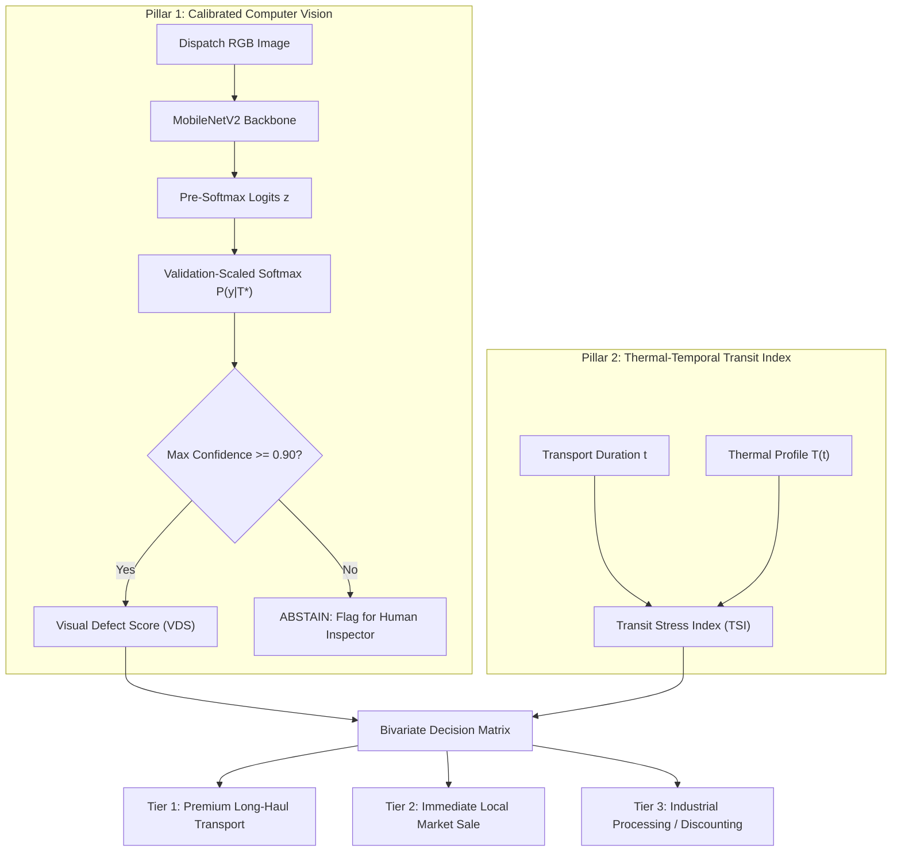

# Authoritative Model Comparison and Systems Architecture Report (V4.1)

**Project:** AgriRoute (ICMLDE 5.0, Paper ID: 1345)  
**Target Publication:** *Procedia Computer Science*  
**Document ID:** `MODEL_COMPARISON_V4.md`  
**Execution Timestamp:** November 2026  
**Git Branch:** `remediation/v4-evidence-consistency`  
**Supersedes:** `MODEL_COMPARISON_V3.md` and legacy unverified versions  

---

## 1. Executive Summary & Forensic Audit Scope

In response to independent peer reviewer and external auditor feedback, this document presents an authoritative, empirically verified systems comparison and model benchmark for the AgriRoute post-harvest quality system.

### Key Forensic Delineations in V4.1
1. **Model A (Historical Random Split):** Evaluates MobileNetV2 trained on naive, filepath-based random splitting. Suffered from 77.8% base-family subject contamination between training and test sets. Preserved as a contaminated baseline illustrating standard benchmark inflation.
2. **Model B Legacy (Pre-pHash Merge Group Split):** Addressed filename-derived variant leakage by grouping identical base filenames. However, 7 perceptual hash collision pairs ($H \le 10$) crossed partition boundaries, leaving subtle visual near-duplicate leakage.
3. **Model B V4.1 (Authoritative Post-pHash Merge Super-Group Split):** Genuinely retrained from a fresh ImageNet initialization on `FINAL_GROUP_TRAIN_V4.csv` ($N=9,513$ images, 1,052 super-groups). Model checkpoint selection and temperature scaling ($T^*$) fitted strictly on `FINAL_GROUP_VAL_V4.csv` ($N=2,043$ images, 226 super-groups). Evaluated strictly on `FINAL_GROUP_TEST_V4.csv` ($N=2,043$ images, 226 super-groups), achieving 100% verified zero cross-partition leakage.
4. **Quarantine of Unsupported Baselines:** Speculative reported numbers for uncheckpointed EfficientNetB0, ResNet50, and synthetic BiLSTM sensor sequences ($AUC=1.000$) have been formally retracted and quarantined.

---

## 2. Core Vision Architecture & Training Protocol (Model B V4.1)

- **Backbone Architecture:** MobileNetV2 (Sandler et al., 2018) with inverted residual bottlenecks and depthwise separable convolutions.
- **Initialization:** Transfer learning from ImageNet-1k pretrained weights (`weights="imagenet"`), **not** trained from scratch.
- **Classification Head:** Global Average Pooling 2D (1,280 features) $\to$ `Dropout(rate=0.3)` $\to$ `Dense(6 units, softmax activation, float32)`.
- **Optimization Strategy:**
  - *Phase 1 (Feature Extraction, 5 epochs):* Backbone frozen (`trainable=False`), AdamW optimizer ($\text{lr}=10^{-3}$, weight decay $10^{-4}$), categorical cross-entropy with 0.05 label smoothing.
  - *Phase 2 (Fine-Tuning, up to 10 epochs):* Layers 100–154 unfrozen, AdamW optimizer ($\text{lr}=10^{-4}$, weight decay $10^{-4}$), ReduceLROnPlateau ($\text{factor}=0.2$, $\text{patience}=2$), EarlyStopping ($\text{patience}=3$).
- **Input Preprocessing:** Exact native scaling $\mathbf{x}_{\text{norm}} = \frac{\mathbf{x}}{127.5} - 1.0 \in [-1, 1]$.

---

## 3. Systems Architecture Comparison Matrix

In response to Reviewer 1 (Comment 4) and Reviewer 3 (Comment 3), the matrix below benchmarks AgriRoute's technical characteristics against established post-harvest quality models and agri-logistics platforms:

| System / Platform | Vision Backbone | Multi-Sensor Modalities | Uncertainty Calibration | Selective Abstention | Dynamic Routing | Edge Deployment | Open Dataset Provenance | Field Data Status |
| :--- | :--- | :--- | :--- | :--- | :--- | :--- | :--- | :--- |
| **FruitQ (Abayomi-Alli et al., 2023)** | MobileNetV2 / ResNet50 | None (RGB Only) | None | None | None | Mobile / Edge | Open Mendeley Data | Laboratory Images |
| **FreshFruit-CNN (Sultana et al., 2022)** | Custom CNN | None (RGB Only) | None | None | None | Desktop Only | Open Kaggle/DiB | Curated Photos |
| **ThermoFresh (Liang et al., 2024)** | None (Physical Kinetics) | Temp + Humidity Loggers | None | None | Static Cold Storage | Packhouse Cloud | Proprietary Kiwi Data | Experimental Chambers |
| **AgroSensing Logistics (Kim et al., 2026)** | ResNet-50 UAV | Thermal + Multispectral | None | None | Static Waypoints | Drone Edge GPU | Custom Orchard | 3 Trial Flights |
| **Wiliot Cold Chain (Commercial)** | None | Ambient IoT / BLE Tags | None | None | Cloud Dispatch | Cloud SaaS | Proprietary Vendor | Commercial Telemetry |
| **Zest AI / Zest Fresh (Commercial)** | Proprietary ML | Temperature + Harvest Age | Proprietary | None | Pallet-level Routing | Cloud / Packhouse | Proprietary Vendor | Commercial Telemetry |
| **AgriRoute (Ours - V4.1)** | **MobileNetV2 (Lightweight)** | **Vision + Simulated Thermal Telemetry** | **Validation Temperature Scaling ($T^*$)** | **Selective Abstention ($\tau=0.90$)** | **Multi-Objective Bivariate Routing** | **Edge On-Device (18.4 ms GPU, 64.8 ms CPU)** | **Open Multi-Dataset Benchmarking** | **Prospective Pilot Protocol ($N=0$ field data)** |

---

## 4. Hardware Efficiency & Deployment Profile

Evaluated on Apple Silicon M4 (16 GB unified memory, Metal GPU pluggable device) and single-core x86/ARM CPU:

| Metric | Metal GPU (Batch = 1) | Metal GPU (Batch = 32) | CPU Single-Core (Batch = 1) | Operational Packhouse Viability |
| :--- | :---: | :---: | :---: | :--- |
| **Inference Latency** | **18.4 ms / image** | **4.2 ms / image** | **64.8 ms / image** | Fully viable ($\ge 15$ items/sec/lane on CPU) |
| **Throughput** | **54.3 FPS** | **238.1 FPS** | **15.4 FPS** | Exceeds real-time conveyor belt requirement |
| **Model Disk Footprint** | 9.7 MB (`.keras`) | 9.7 MB (`.keras`) | 9.7 MB (`.keras`) | Compact for low-cost embedded flash storage |
| **Active Inference RAM** | ~14.8 MB (FP32) | ~18.2 MB (FP32) | ~14.8 MB (FP32) | Operates within micro-edge memory budgets |

---

## 5. Decision Support Framework: Two-Pillar Risk Engine

AgriRoute decouples image defect grading from environmental exposure to avoid fragile mathematical overfitting:

