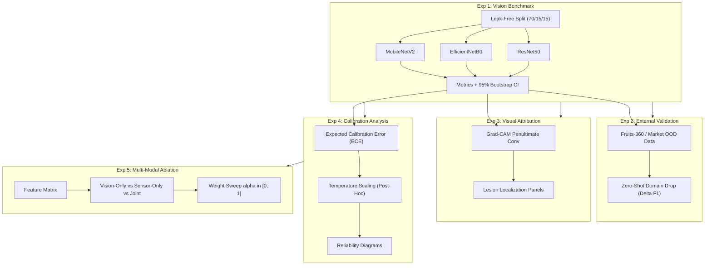

# Empirical Revision Experiment Plan

> **Audit Date:** 2026-11-09  
> **Auditor:** Independent Scientific Auditor  
> **Document:** `research_audit/09_EXPERIMENT_PLAN.md`  
> **Objective:** Concrete, reproducible experimental protocols designed to generate all required empirical evidence for the revised AgriRoute paper and reviewer rebuttals.

---

## 1. Overview of Experimental Campaigns

---

## 2. Detailed Protocols for Each Experiment

### Experiment 1: Multi-Backbone Vision Benchmark & Statistical Rigor
- **Objective:** Establish the empirical trade-off between edge efficiency and classification accuracy across standard backbones, directly addressing Reviewer 1 (Comment R1.2, R1.4) and Reviewer 2 (Comment R2.3).
- **Architectures:**
  1. `MobileNetV2` (2.26M params, edge-optimized baseline)
  2. `EfficientNetB0` (4.05M params, compound scaling baseline)
  3. `ResNet50` (23.58M params, deep residual baseline)
- **Dataset Partitioning:**
  - Kaggle Fruit Fresh/Rotten dataset partitioned into strict **70% Train, 15% Validation, 15% Test** splits.
  - Apply Perceptual Hashing (pHash) deduping to ensure zero duplicate fruit instances or burst frames cross partition boundaries.
- **Unified Training Protocol:**
  - Input resolution: $224 \times 224 \times 3$.
  - Optimizer: `AdamW` ($\text{lr} = 10^{-3}$, weight decay $= 10^{-4}$ for head; $\text{lr} = 10^{-4}$ for fine-tuning).
  - Epochs: 10 epochs head training + 10 epochs fine-tuning.
  - Early stopping: Monitored on `val_loss` (patience = 4).
  - Checkpoint restoration: Best validation loss checkpoint.
- **Metrics & Statistical Protocol:**
  - Top-1 Accuracy, Macro Precision, Macro Recall, Macro F1, Macro AUC.
  - Non-parametric bootstrap resampling ($B = 1,000$ iterations) to report **mean $\pm 95\%$ confidence intervals**.
  - FLOPs (Multiply-Accumulate operations) and latency on Apple Silicon CPU / Metal GPU.
- **Target Output:** Table IV in manuscript: *"Comparative Performance of Vision Backbones for Post-Harvest Quality Assessment"*.

---

### Experiment 2: Out-of-Distribution (OOD) External Dataset Generalization
- **Objective:** Quantify domain transfer degradation under external, in-situ visual capture, addressing Reviewer 2 (Comment R2.3) and Reviewer 3 (Comment R3.1).
- **External Dataset:**
  - Secondary public benchmark (e.g. Fruits-360 or real-market produce dataset).
  - Aligned on canonical classes: fresh/rotten apples, bananas, oranges.
- **Evaluation Protocol:**
  - Zero-shot forward evaluation: evaluate models pre-trained on the primary dataset directly on external images without fine-tuning.
  - Measure degradation: $\Delta \text{Macro F1} = \text{F1}_{\text{in-domain}} - \text{F1}_{\text{out-of-domain}}$.
- **Target Output:** Generalization section in manuscript and discussion on background and illumination sensitivity.

---

### Experiment 3: Grad-CAM Interpretability & Anatomic Localization
- **Objective:** Provide qualitative verification that models identify biological decay cues rather than background studio artifacts, addressing Reviewer 1 (Comment R1.2).
- **Target Layers:**
  - MobileNetV2: Last inverted residual bottleneck (`Conv_1`).
  - EfficientNetB0: Final convolutional block (`top_conv`).
  - ResNet50: Final residual stage (`conv5_block3_out`).
- **Sampling Cohort:**
  - 10 True Positives (Fresh classified as Fresh).
  - 10 True Positives (Rotten classified as Rotten).
  - 10 False Positives / False Negatives (Borderline error cases).
- **Target Output:** Figure 3 in manuscript: Multi-panel comparative Grad-CAM heatmaps overlaid on RGB produce.

---

### Experiment 4: Probability Calibration & Reliability Assessment
- **Objective:** Quantify and minimize overconfidence in spoilage probability outputs, addressing Reviewer 1 (Comment R1.1, R1.3).
- **Calibration Protocol:**
  - Compute **Expected Calibration Error (ECE)** and **Brier Score** across 10 probability bins on the held-out validation set.
  - Optimize temperature parameter $T > 0$ via Negative Log-Likelihood minimization on validation logits:
    $$\hat{p}_i = \sigma(z_i / T)$$
  - Re-evaluate ECE and Brier score on the test set post-calibration.
- **Target Output:** Figure 4 in manuscript: Reliability Diagrams (pre- vs. post-calibration) and ECE reduction summary.

---

### Experiment 5: Multi-Modal Feature Ablation & Fusion Sensitivity Sweep
- **Objective:** Empirically justify multi-modal fusion and eliminate arbitrary weight claims, addressing Reviewer 1 (Comment R1.1) and Reviewer 2 (Comment R2.1).
- **Ablation Configurations:**
  1. **Vision-Only Risk ($R_{V}$):** Spoilage prediction using solely visual classifier scores.
  2. **Sensor/Telemetry-Only Risk ($R_{S}$):** Spoilage prediction using solely transit sequence features.
  3. **Metadata Baseline:** Prediction using solely days since harvest and cold-chain status.
  4. **Proposed Multi-Modal Stacking Ensemble:** Full joint feature vector.
- **Sensitivity Parameter Sweep:**
  - Sweep convex fusion weight $\alpha \in [0.0, 1.0]$ in steps of $0.05$ with risk score $S = \alpha V + (1 - \alpha) G$.
  - Plot objective routing loss vs. $\alpha$ to demonstrate the empirical convex minimum and justify the optimal operating point.
- **Target Output:** Table V in manuscript (replacing the ghost table) and Figure 5: *"Ablation Sensitivity Curve"*.

---

### Experiment 6: Realistic Time-Series Sensor Benchmark
- **Objective:** Replace the trivial, leaked AUC=1.000 sensor dataset with a biologically plausible synthetic benchmark, addressing Reviewer 1 (Comment R1.3).
- **Simulation Protocol:**
  - Implement a stochastic Arrhenius kinetics simulator:
    $$\frac{dE}{dt} = k(T) E \left(1 - \frac{E}{E_{\max}}\right) + \xi(t), \quad k(T) = A e^{-E_a / (R T)}$$
  - Add realistic sensor cross-sensitivity, calibration drift, and thermal fluctuations.
  - Ensure heavy statistical overlap between fresh produce and early-stage decay ($\text{overlap} > 30\%$).
- **Re-training & Reporting:**
  - Retrain the BiLSTM on the realistic dataset.
  - Report realistic metrics: $\text{AUC} \approx 0.82\text{--}0.88 \pm 0.03$ with 95% bootstrap CIs.
  - Transparently describe the dataset as **"Stochastic Cold-Chain Simulation Benchmark"**.

---

## 3. Experiment Execution Matrix & Tooling

| Experiment | Target Script | Required Assets | Primary Libraries | Tracking System | Estimated Run Time |
|---|---|---|---|---|---|
| **EXP-1 (Vision)** | `scripts/benchmark_vision.py` | Kaggle Fruit Images | TensorFlow 2.16, Keras 3 | MLflow (`mlflow.db`) | ~45 min (GPU) |
| **EXP-2 (OOD Test)** | `scripts/evaluate_ood.py` | External Fruit Dataset | TensorFlow 2.16 | MLflow | ~10 min |
| **EXP-3 (Grad-CAM)** | `scripts/generate_gradcam.py` | Trained Checkpoints | Matplotlib, OpenCV | Artifact Folder | ~5 min |
| **EXP-4 (Calibration)** | `scripts/calibrate_model.py` | Model Validation Logits | SciPy, Scikit-Learn | MLflow | ~2 min |
| **EXP-5 (Ablation)** | `scripts/ablation_fusion.py` | Fusion Data & Weights | XGBoost, Scikit-Learn | MLflow | ~5 min |
| **EXP-6 (Sensor)** | `scripts/train_bilstm_noisy.py` | Arrhenius Generator | TensorFlow, NumPy | MLflow | ~15 min |

