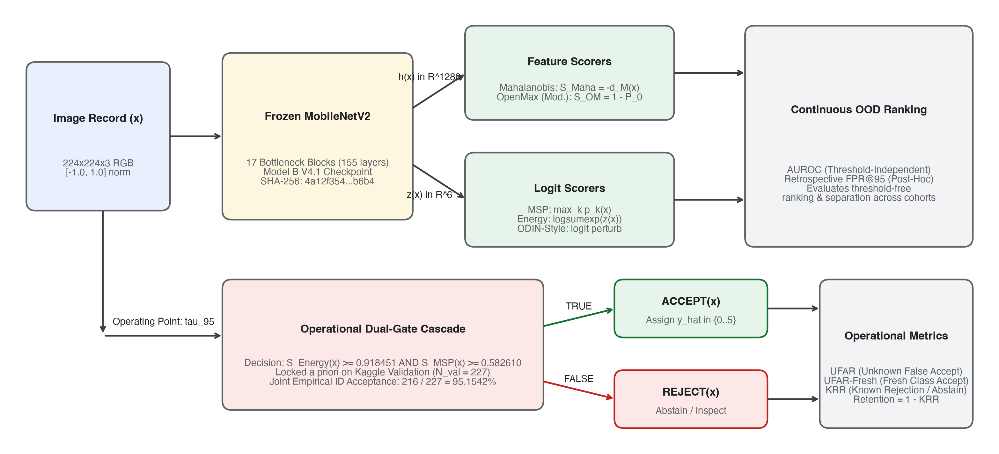

# Section 4: Methodology

This section details the computational methods, feature representations, post-hoc scoring algorithms, operational decision logic, threshold calibration protocol, and statistical reporting standards employed in this study. The present research constitutes an empirical evaluation and failure diagnosis of established methods rather than a proposal for a novel out-of-distribution (OOD) algorithm.

## 4.1. Methodological Overview

The end-to-end evaluation pipeline is illustrated in Figure 1. The computational framework separates image processing and evaluation into four functional stages:

1. **Image Ingestion and Preprocessing:** Input photographic image records are decoded, bilinearly resized to $224 \times 224 \times 3$, and mapped to the standardized dynamic range $[-1.0, 1.0]$.
2. **Frozen Backbone Inference and Feature Extraction:** Preprocessed images are passed through a frozen MobileNetV2 architecture [7]. We extract both the 1280-dimensional penultimate feature representation $h(x) \in \mathbb{R}^{1280}$ (from global average pooling) and the unnormalized logit vector $z(x) \in \mathbb{R}^6$, from which softmax class posterior probabilities $p(x) = \operatorname{softmax}(z(x))$ are generated.
3. **Post-hoc OOD Scoring:** Five established scoring functions are computed from the extracted representations: Maximum Softmax Probability (MSP) [9], Energy-based scoring [18], ODIN with input perturbation [16], Ledoit-Wolf Mahalanobis distance [17], and OpenMax with Weibull tail fitting [14].
4. **Operational Decision Gating and Multi-Level Evaluation:** Continuous scores are mapped to discrete acceptance/rejection decisions via fixed prospective operating thresholds calibrated on validation data. Model performance is comprehensively evaluated across: (i) closed-set classification accuracy on knowns, (ii) continuous threshold-free OOD ranking discrimination (AUROC, FPR@95), and (iii) fixed-threshold operational rejection rates (UFAR, UFAR-Fresh, KRR).


*Figure 1: End-to-end methodological pipeline of the source-stratified evaluation benchmark. Photographic image records are processed by a frozen MobileNetV2 backbone (checkpoint SHA-256: `4a12f354...b6b4`) to extract penultimate features $h(x) \in \mathbb{R}^{1280}$ and logits $z(x) \in \mathbb{R}^6$. Five post-hoc scoring functions are evaluated for continuous OOD ranking. Operating thresholds locked a priori on validation knowns ($N_{\text{val}} = 227$) govern discrete acceptance ($\hat{y} \in \{0, \dots, 5\}$) or rejection ($\hat{y} = \text{\textcircled{r}}$) via the Energy–MSP Dual-Gate cascade.*

---

## 4.2. Frozen MobileNetV2 Classifier

The classification backbone is a lightweight convolutional neural network based on the MobileNetV2 architecture [7], designed for resource-constrained edge execution.

### 4.2.1. Architecture and Output Space
The network comprises an initial $3 \times 3$ standard convolution followed by 17 bottleneck blocks: 1 initial inverted bottleneck stage without expansion and 16 inverted residual bottleneck blocks with depthwise separable convolutions and linear bottlenecks (expansion factor 6) [7]. In the Keras functional implementation, the feature extractor encompasses 155 layer operations terminating in a global average pooling layer that compresses spatial feature maps into a $D = 1280$ dimensional embedding $h(x) \in \mathbb{R}^{1280}$. The classification head consists of a dropout layer ($p = 0.3$) followed by a single fully connected dense layer parameterised by weight matrix $W \in \mathbb{R}^{1280 \times 6}$ and bias vector $b \in \mathbb{R}^6$:

$$z(x) = W^\top h(x) + b, \quad z(x) \in \mathbb{R}^6.$$

The discrete target label space encompasses $K = 6$ commercial fruit freshness classes:

$$\mathcal{Y} = \{ 0: \text{fresh\_apple}, \; 1: \text{fresh\_banana}, \; 2: \text{fresh\_orange}, \; 3: \text{rotten\_apple}, \; 4: \text{rotten\_banana}, \; 5: \text{rotten\_orange} \}.$$

### 4.2.2. Model Provenance and Immutability Safeguards
The evaluated model (designated Model B V4.1) was trained on $N_{\text{train}} = 9,513$ images from the primary Kaggle archive using AdamW optimization (initial learning rate $10^{-3}$, weight decay $10^{-4}$, label smoothing $\alpha = 0.05$) under group-aware partition separation. The final model checkpoint is stored as `MODEL_B_V4_1_CHECKPOINT.keras` and verified by cryptographic checksum:

```
SHA-256: 4a12f354a4157d2b04ed9606df7112c663fe000d924c5264b5f2fa1b3932b6b4
```

Throughout all external evaluations across Partitions B, C, D1, and D2, this checkpoint remained strictly frozen (`training=False`). No weights, biases, batch normalization statistics, or hyperparameters were adjusted or fine-tuned.

### 4.2.3. Input Preprocessing
Input images of arbitrary resolution and aspect ratio are decoded from raw JPEG/PNG formats, resized to $(224, 224, 3)$ using bilinear interpolation, and converted to 32-bit floating-point tensors. Pixel intensities in $[0, 255]$ are normalized according to the standard MobileNetV2 mapping:

$$x_{\text{norm}} = \frac{x}{127.5} - 1.0 \in [-1.0, 1.0]^3.$$

---

## 4.3. Post-Hoc OOD Detection Scoring Functions

We evaluate five established post-hoc scoring algorithms, covering posterior probabilities, energy modeling, input perturbation, distance-based feature modeling, and extreme value theory. Table 5 summarizes their mathematical definitions, input representations, score orientations, and implementation hyperparameters.

### Table 5: Post-Hoc Out-of-Distribution Detector Formulations and Verified Configurations
*All scores are oriented such that higher values indicate in-distribution confidence, ensuring consistency across continuous AUROC ranking and operational decision gating.*

| Scoring Method | Mathematical Formulation | Input Layer | Score Direction | Verified Implementation Settings |
| :--- | :--- | :---: | :---: | :--- |
| **MSP** <br> Hendrycks & Gimpel [9] | $S_{\text{MSP}}(x) = \max_{k} \frac{\exp(z_k(x))}{\sum_j \exp(z_j(x))}$ | Logits $z(x) \in \mathbb{R}^6$ | Higher $\implies$ ID <br> Anomaly: $-S_{\text{MSP}}$ | Standard softmax posterior; temperature $T = 1.0$; zero hyperparameter tuning. |
| **Energy** <br> Liu et al. [18] | $S_{\text{Energy}}(x) = T \cdot \log \sum_{k=1}^K \exp(z_k(x) / T)$ | Logits $z(x) \in \mathbb{R}^6$ | Higher $\implies$ ID <br> Anomaly: $-S_{\text{Energy}}$ | Free-energy score; temperature $T = 1.0$; computed via `logsumexp`. Post-hoc score, not generative density $p(x)$. |
| **ODIN (Variant)** <br> Liang et al. [16] | $S_{\text{ODIN}}(x) = \max_{k} \frac{\exp(z_k(\tilde{x}) / T)}{\sum_j \exp(z_j(\tilde{x}) / T)}$ <br> $\tilde{x} = \operatorname{clip}(x + \varepsilon \operatorname{sign}(\nabla_x \max_k z_k / T))$ | Image $x$ and logits $z(x)$ | Higher $\implies$ ID <br> Anomaly: $-S_{\text{ODIN}}$ | ODIN-style perturbation variant; gradient on max temperature-scaled logit; $T = 1000.0$; $\varepsilon = 0.0014$; clipped to $[-1.0, 1.0]$. |
| **Mahalanobis** <br> Lee et al. [17] | $S_{\text{Maha}}(x) = - \min_c d_M(h(x), \mu_c)$ <br> $d_M = \sqrt{(h(x) - \mu_c)^\top \Sigma_{\text{LW}}^{-1} (h(x) - \mu_c)}$ | Features $h(x) \in \mathbb{R}^{1280}$ | Higher $\implies$ ID <br> Anomaly: $d_M(x)$ | Class centroids $\mu_c$; shared covariance with Ledoit-Wolf shrinkage $\Sigma_{\text{LW}}$; negated distance. |
| **OpenMax (Mod.)** <br> Bendale & Boult [14] | $S_{\text{OpenMax}}(x) = 1.0 - p_{\text{OM}}(y = 0)$ <br> $w_{c_r} = 1.0 - \frac{r-1}{\alpha}(1 - \omega_r)$ | Features $h(x)$ and logits $z(x)$ | Higher $\implies$ ID <br> Anomaly: $p_{\text{OM}}(0) - 1$ | Modified OpenMax-style heuristic; 1280-D global pooled features; Weibull tail $\eta = 20$; $\alpha = 2$; rank weighting gives top-1 class zero logit discount. |

### 4.3.1. Maximum Softmax Probability (MSP)
The baseline detector proposed by Hendrycks and Gimpel [9] computes the maximum posterior probability across known classes:

$$p_k(x) = \frac{\exp(z_k(x))}{\sum_{j=1}^K \exp(z_j(x))}, \quad S_{\text{MSP}}(x) = \max_{k \in \{0, \dots, K-1\}} p_k(x).$$

Because softmax normalization enforces $\sum_k p_k(x) = 1$, the score $S_{\text{MSP}}(x) \in (1/K, 1]$ directly reflects the classifier's relative confidence. Higher MSP values indicate in-distribution confidence; lower values indicate uncertainty. For AUROC calculations where out-of-distribution instances represent the positive class ($y_{\text{ood}} = 1$), the anomaly ranking score is $-S_{\text{MSP}}(x)$.

### 4.3.2. Energy-Based OOD Detection
To overcome softmax probability saturation on anomalous inputs, Liu et al. [18] proposed an energy-based scoring function derived from the Helmholtz free energy. In physical systems, the free energy $E(x; f)$ is defined as $E(x; f) = -T \cdot \log \sum_k \exp(z_k(x) / T)$. In this study, to maintain mathematical consistency with the operational Dual-Gate acceptance equation ($S(x) \ge \tau$), we define the in-distribution energy score directly as the negative free energy (the log-sum-exp of logits):

$$S_{\text{Energy}}(x) = T \cdot \log \sum_{k=0}^{K-1} \exp\left(\frac{z_k(x)}{T}\right).$$

In our implementation, the temperature is set to $T = 1.0$, simplifying the formulation to $S_{\text{Energy}}(x) = \operatorname{logsumexp}(z(x))$. Higher energy scores indicate larger unnormalized logit magnitudes and higher in-distribution confidence. We emphasize that $S_{\text{Energy}}(x)$ represents a post-hoc discriminator score, and is not claimed to represent an exact generative data density $p(x)$.

### 4.3.3. ODIN-Style Perturbation Variant
The ODIN framework proposed by Liang et al. [16] combines temperature scaling with adversarial input perturbation to enlarge score separation between in-distribution and anomalous inputs. In canonical ODIN, the input perturbation is derived from the gradient of the negative log temperature-scaled softmax probability of the predicted class: $-\log S_{\hat{y}}(x; T_{\text{ODIN}})$. In our canonical benchmark implementation (`scripts/run_stage4_1_benchmark.py`), an ODIN-style perturbation variant is evaluated where the gradient target is the maximum temperature-scaled logit:

1. **Input Perturbation:** The input image is perturbed along the sign of the gradient of the maximum temperature-scaled logit:
   $$x_{\text{perturbed}} = \operatorname{clip}\left( x + \varepsilon_{\text{ODIN}} \cdot \operatorname{sign}\left( \nabla_x \max_{k} \frac{z_k(x)}{T_{\text{ODIN}}} \right), \; -1.0, \; 1.0 \right).$$
   Because input imagery is preprocessed via the standard MobileNetV2 normalization mapping $x_{\text{norm}} \in [-1.0, 1.0]^3$, perturbed values are strictly clipped to the valid dynamic range $[-1.0, 1.0]$.
2. **Temperature-Scaled Confidence Scoring:** The perturbed image $x_{\text{perturbed}}$ is passed through the network, and the score is computed as the maximum temperature-scaled softmax probability:
   $$S_{\text{ODIN}}(x) = \max_{k \in \{0, \dots, K-1\}} \frac{\exp(z_k(x_{\text{perturbed}}) / T_{\text{ODIN}})}{\sum_{j=0}^{K-1} \exp(z_j(x_{\text{perturbed}}) / T_{\text{ODIN}})}.$$

In our canonical implementation, hyperparameters are locked at $T_{\text{ODIN}} = 1000.0$ and $\varepsilon_{\text{ODIN}} = 0.0014$, verified against `scripts/run_stage4_1_benchmark.py`. We explicitly document this implementation as an ODIN-style variant optimizing the top logit directly rather than canonical cross-entropy loss. Higher values denote in-distribution confidence.

### 4.3.4. Mahalanobis Distance
Following Lee et al. [17], the Mahalanobis detector models penultimate feature representations using class-conditional Gaussian distributions with a tied covariance matrix.

1. **Centroid Estimation:** Using training features $h(x) \in \mathbb{R}^{1280}$, class mean vectors are computed as:
   $$\mu_c = \frac{1}{N_c} \sum_{i : y_i = c} h(x_i), \quad c \in \{0, \dots, K-1\}.$$
2. **Regularized Covariance Estimation:** To ensure invertibility and mitigate singularity in high-dimensional feature space ($D = 1280$), the shared covariance matrix is estimated using the Ledoit--Wolf shrinkage estimator on centered training features:
   $$\Sigma_{\text{LW}} = (1 - \rho) \Sigma_{\text{sample}} + \rho \, \nu I_D,$$
   where $\rho \in [0, 1]$ is the analytically optimal shrinkage intensity and $\nu = \frac{1}{D} \operatorname{tr}(\Sigma_{\text{sample}})$.
3. **Score Formulation:** For test input $x$, the squared Mahalanobis distance to the closest class centroid is computed:
   $$d_M^2(x) = \min_{c \in \{0, \dots, K-1\}} (h(x) - \mu_c)^\top \Sigma_{\text{LW}}^{-1} (h(x) - \mu_c).$$
   To maintain directional alignment with other detectors, the score is defined as the negated distance:
   $$S_{\text{Maha}}(x) = - \sqrt{\max\left(d_M^2(x), 0\right)}.$$
   Higher values of $S_{\text{Maha}}(x)$ indicate closer proximity to training class clusters (in-distribution), whereas large negative values indicate anomalous outliers.

### 4.3.5. Modified OpenMax-Style Heuristic
Bendale and Boult [14] introduced OpenMax to calibrate classification logits using Extreme Value Theory (EVT) and estimate an explicit open-set unknown probability. In this study, the benchmark evaluates a modified OpenMax-style heuristic characterized by two implementation specifics:

1. **Feature Embedding Representation:** Class Mean Activation Vectors (MAVs) $\mu_c^{\text{MAV}} \in \mathbb{R}^{1280}$ and Euclidean distance modeling are evaluated on the 1280-dimensional global-average-pooled penultimate feature embedding $h(x) \in \mathbb{R}^{1280}$, rather than the multi-dimensional spatial activation tensors or layer-specific activation vectors of the original 2016 architecture.
2. **Weibull Tail Fitting:** For each class $c$, Euclidean distances $\|h(x_i) - \mu_c^{\text{MAV}}\|_2$ are computed over correctly classified training samples. A Weibull distribution $\operatorname{Weibull}(\text{shape}_c, \text{scale}_c)$ is fitted to the $\eta = 20$ largest distances (tail size $\eta = 20$, location parameter fixed at 0).
3. **Rank-Weighting Formulation and Deviation:** At inference, classes are ranked in descending order of logits $z_{(1)}(x) \ge z_{(2)}(x) \ge \dots \ge z_{(K)}(x)$. For the top $\alpha = 2$ ranked classes (with 1-based rank index $r \in \{1, \dots, \alpha\}$, corresponding to 0-based index $r-1$), the Weibull survival probability is evaluated:
   $$\omega_r(x) = \exp\left( - \left( \frac{\|h(x) - \mu_{c_r}^{\text{MAV}}\|_2}{\text{scale}_{c_r} + 10^{-8}} \right)^{\text{shape}_{c_r}} \right).$$
   The logit adjustment weight implemented in the canonical codebase (`scripts/run_stage4_1_benchmark.py`) is:
   $$w_{c_r} = 1.0 - \frac{r - 1}{\alpha} (1.0 - \omega_r(x)),$$
   while unranked classes retain $w_k = 1.0$. Crucially, under this formulation, the highest-ranked class ($r = 1$) receives $\frac{1 - 1}{\alpha} = 0$, yielding $w_{c_1} = 1.0$ regardless of $\omega_1(x)$. Consequently, the top-1 predicted logit undergoes zero logit discounting, and Weibull probability recalibration affects only the second-ranked class ($r = 2$, receiving $w_{c_2} = 1.0 - 0.5(1.0 - \omega_2(x))$). This represents a distinct modified OpenMax-style heuristic compared to canonical OpenMax, where the top-ranked class receives the strongest Weibull tail calibration.
4. **Synthetic Unknown Class Softmax:** An augmented pseudo-logit for the unknown class (index 0) is constructed as:
   $$\hat{v}_0(x) = \sum_{k=0}^{K-1} z_k(x) (1.0 - w_k), \quad \hat{v}_{k+1}(x) = z_k(x) \cdot w_k.$$
   Applying softmax across the resulting $K+1$ logits produces posterior probability vector $p_{\text{OM}} \in \Delta^K$. The in-distribution confidence score is defined as:
   $$S_{\text{OpenMax}}(x) = 1.0 - p_{\text{OpenMax}}(y = 0).$$
   Higher values indicate that the produce belongs to one of the six known classes; lower values reflect high open-set unknown probability.

---

## 4.4. Operational Energy--MSP Dual-Gate Cascade

In agricultural packaging and sorting operations, continuous anomaly scores must be converted into deterministic routing decisions: either accepting the produce item for automated packaging under the classifier's top-1 predicted label, or rejecting the item to an abstention bin for manual inspection.

### 4.4.1. Motivation and Cascade Formulation
Empirical analysis reveals that standalone detectors exhibit complementary failure modes: Energy scores capture unnormalized activation magnitude and separate coarse semantic out-of-distribution produce, whereas MSP reflects posterior distribution peakedness and discriminates ambiguous in-distribution boundaries. The Dual-Gate cascade integrates both criteria into an operational decision heuristic.

We emphasize that the Dual-Gate cascade is an *operational decision rule*, not a novel standalone mathematical model or learning algorithm. For any incoming image $x$, the discrete acceptance decision is defined as:

$$\operatorname{ACCEPT}(x) \iff S_{\text{Energy}}(x) \ge \tau_E \;\land\; S_{\text{MSP}}(x) \ge \tau_M.$$

Otherwise:

$$\operatorname{REJECT}(x) \iff S_{\text{Energy}}(x) < \tau_E \;\lor\; S_{\text{MSP}}(x) < \tau_M.$$

When $\operatorname{ACCEPT}(x) = 1$, the model assigns its closed-set predicted class:

$$\hat{y}(x) = \arg\max_{k \in \{0, \dots, 5\}} z_k(x).$$

When $\operatorname{REJECT}(x) = 1$, the system abstains from classification and routes the image record to manual review ($\hat{y}(x) = \text{\textcircled{r}}$).

### 4.4.2. Continuous Margin Proxy for Exploratory AUROC
Because the Dual-Gate rule evaluates a Boolean conjunction ($g_E(x) \land g_M(x)$), it produces a discrete binary decision ($\{0, 1\}$) rather than a continuous ranking score, and therefore cannot directly generate an ROC curve without a continuous ranking proxy. To permit exploratory comparative ROC analysis in benchmark tables, we compute a continuous linear margin proxy:

$$S_{\text{proxy}}(x) = (S_{\text{Energy}}(x) - \tau_E) + (S_{\text{MSP}}(x) - \tau_M).$$

We emphasize that this continuous linear margin proxy is strictly an exploratory metric. Because raw Energy scores (log-sum-exp of logits, typical range $[0, 10]$) and MSP scores (posterior probabilities in $(1/6, 1]$) reside on substantially different numerical scales, this unweighted additive combination is inherently scale-dependent and dominated by Energy variations. The proxy does not constitute a canonical continuous score of the Dual-Gate. All operational routing and acceptance metrics (UFAR, UFAR-Fresh, KRR, Retention) are evaluated strictly using the exact discrete Boolean conjunction in Eq. (171).

---

## 4.5. Validation-Based Operating-Threshold Calibration

To reduce potential circularity and data-snooping bias, all operating thresholds were calibrated strictly on an independent primary validation partition and locked prior to external evaluation.

### 4.5.1. Calibration Population
The calibration population comprises $N_{\text{val}} = 227$ raw photographic images from the primary Kaggle validation split (`FINAL_GROUP_VAL_V4_1.csv`, filtered by `is_raw == 1`). This set contains 35 fresh apples, 49 rotten apples, 33 fresh bananas, 46 rotten bananas, 31 fresh oranges, and 33 rotten oranges. As established in Section 3.7, MD5 cryptographic hashing confirms zero file overlap with the 227-image test set (Partition A), and the 227 validation images are completely excluded from the 13,465-image evaluation census.

### 4.5.2. Order-Statistic Calibration Protocol
Thresholds were derived using non-parametric empirical order statistics to target approximately 95% in-distribution acceptance coverage ($\tau_{95}$, corresponding to an empirical false rejection / abstention budget of $\le 5.0\%$). Table 6 details the exact calibration parameters, order-statistic indices, and empirical validation coverage for each configuration.

### Table 6: Calibrated Operating Thresholds ($\tau_{95}$) Determined on Validation Data ($N_{\text{val}} = 227$)
*Standalone single-gate thresholds are locked at the 12th smallest order statistic ($s_{(12)}$), achieving $95.1542\%$ empirical in-distribution coverage. In the operational Dual-Gate cascade, individual thresholds are relaxed to the 7th smallest order statistic ($s_{(7)}$) to maintain the identical $95.1542\%$ empirical validation coverage under joint evaluation.*

| Configuration / Detector | Score Symbol | Locked Threshold ($\tau_{95}$) | Order-Statistic Index ($s_{(k)}$) | Validation Rejected / Accepted | Empirical ID Coverage | Operational Comparison Rule |
| :--- | :---: | :---: | :---: | :---: | :---: | :--- |
| **MSP (Single Gate)** | $S_{\text{MSP}}$ | 0.700580 | 12th smallest $s_{(12)}$ (index 11) | 11 rejected / 216 accepted | 95.1542\% | $\operatorname{ACCEPT} \iff S_{\text{MSP}} \ge 0.700580$ |
| **Energy (Single Gate)** | $S_{\text{Energy}}$ | 1.054579 | 12th smallest $s_{(12)}$ (index 11) | 11 rejected / 216 accepted | 95.1542\% | $\operatorname{ACCEPT} \iff S_{\text{Energy}} \ge 1.054579$ |
| **ODIN (Single Gate)** | $S_{\text{ODIN}}$ | 0.167164 | 12th smallest $s_{(12)}$ (index 11) | 11 rejected / 216 accepted | 95.1542\% | $\operatorname{ACCEPT} \iff S_{\text{ODIN}} \ge 0.167164$ |
| **Mahalanobis (Single Gate)** | $S_{\text{Maha}}$ | -65.133230 | 12th smallest $s_{(12)}$ (index 11) | 11 rejected / 216 accepted | 95.1542\% | $\operatorname{ACCEPT} \iff S_{\text{Maha}} \ge -65.133230$ |
| **OpenMax (Single Gate)** | $S_{\text{OpenMax}}$ | 0.778938 | 12th smallest $s_{(12)}$ (index 11) | 11 rejected / 216 accepted | 95.1542\% | $\operatorname{ACCEPT} \iff S_{\text{OpenMax}} \ge 0.778938$ |
| **Dual-Gate Cascade** <br> (Energy AND MSP) | $\tau_E \text{ and } \tau_M$ | $\tau_E = 0.918451$ <br> $\tau_M = 0.582610$ | 7th smallest $s_{(7)}$ (index 6) on both scores | $\|R_1\|=6, \|R_2\|=6$ <br> $\|R_1 \cap R_2\|=1 \implies$ 11 rejected / 216 accepted | 95.1542\% | $\operatorname{ACCEPT} \iff$ <br> $S_{\text{Energy}} \ge 0.918451 \;\land$ <br> $S_{\text{MSP}} \ge 0.582610$ |

1. **Standalone Single-Gate Thresholds:** Let $\{s_{(1)} \le s_{(2)} \le \dots \le s_{(N_{\text{val}})}\}$ denote the sorted validation scores of a detector. Selecting the 12th smallest order statistic ($s_{(12)}$, 0-indexed position 11) establishes a threshold that rejects the 11 smallest scores ($S < s_{(12)}$) and accepts the remaining $227 - 11 = 216$ samples:
   $$\text{Empirical In-Distribution Coverage} = \frac{216}{227} \approx 95.1542\%.$$
   Under this rule, standalone Energy yields $\tau_{\text{Energy}} = 1.054579$ and standalone MSP yields $\tau_{\text{MSP}} = 0.700580$.
2. **Joint Dual-Gate Calibration via Inclusion--Exclusion:** If the standalone thresholds were applied simultaneously in an AND-rule, rejections would compound: $|R_{\text{union}}| = |R_E \cup R_M| > 11$, reducing in-distribution acceptance far below 95\%. To maintain matched $95.1542\%$ empirical coverage, the thresholds for both gates are jointly calibrated using empirical set intersection:
   - Gate 1 (Energy) threshold is relaxed to the 7th smallest order statistic ($s_{(7)}$, index 6): $\tau_E = 0.918451$, rejecting $|R_1| = 6$ samples.
   - Gate 2 (MSP) threshold is relaxed to the 7th smallest order statistic ($s_{(7)}$, index 6): $\tau_M = 0.582610$, rejecting $|R_2| = 6$ samples.
   - Exactly 1 sample falls below both thresholds simultaneously: $|R_1 \cap R_2| = 1$.
   - By the inclusion--exclusion principle, the total number of rejected validation samples is:
     $$|R_{\text{union}}| = |R_1| + |R_2| - |R_1 \cap R_2| = 6 + 6 - 1 = 11.$$
   - The joint in-distribution acceptance count is exactly $227 - 11 = 216$, matching the canonical $95.1542\%$ empirical validation coverage.

We emphasize that the observed $95.1542\%$ validation coverage represents an empirical sample proportion, not a guaranteed population-level coverage certificate; with $N_{\text{val}} = 227$, the 95\% Clopper--Pearson exact binomial interval spans $[91.43\%, 97.60\%]$.

---

## 4.6. Evaluation Metrics

To evaluate model performance across multiple operational dimensions, we define three categories of metrics, summarized in Table 7.

### Table 7: Authoritative Evaluation Metrics Across Closed-Set Classification, Continuous OOD Ranking, and Operational Gating

| Metric Name | Category | Mathematical Formulation | Target Direction | Operational Scope and Meaning |
| :--- | :---: | :--- | :---: | :--- |
| **Top-1 Accuracy** | Closed-Set Classification | $\text{Acc} = \frac{1}{N} \sum_{i=1}^N \mathbf{1}\{\hat{y}_i = y_i\}$ | Higher ($\uparrow$) | Overall proportion of correct predictions across known classes $\mathcal{Y}$. |
| **Balanced Accuracy** | Closed-Set Classification | $\text{BalAcc} = \frac{1}{K} \sum_{k=0}^{K-1} \frac{\text{TP}_k}{N_k}$ | Higher ($\uparrow$) | Unweighted macro-averaged recall across all 6 known classes; eliminates class-imbalance bias. |
| **Macro-Averaged F1** | Closed-Set Classification | $\text{Macro-F1} = \frac{1}{K} \sum_{k=0}^{K-1} \frac{2 P_k R_k}{P_k + R_k}$ | Higher ($\uparrow$) | Harmonic mean of class-wise precision and recall; treats all 6 target classes with equal weight. |
| **AUROC** | Continuous OOD Ranking | $\text{AUROC} = \int_{0}^1 \text{TPR}(\tau) \, d(\text{FPR}(\tau))$ | Higher ($\uparrow$) | Area under ROC curve treating OOD as positive ($y_{\text{ood}} = 1$); threshold-independent ranking. |
| **Retrospective FPR@95** | Retrospective OOD Separation | $\text{FPR@95} = \frac{\|\{x \in \mathcal{D}_{\text{ood}} : S(x) \ge \tau_{95}^{\text{test}}\}\|}{\|\mathcal{D}_{\text{ood}}\|}$ | Lower ($\downarrow$) | False positive rate on OOD when $\tau_{95}^{\text{test}}$ fixes ID TPR at 95.0\%; retrospective operating-point metric, not threshold-independent. |
| **OSCR** | Open-Set Classification | $\text{OSCR} = \int_{0}^1 \text{CCR}(\tau) \, d(\text{FPR}(\tau))$ | Higher ($\uparrow$) | Area under Correct Classification Rate vs. False Positive Rate curve. |
| **Operational UFAR** | Operational Rejection Gating | $\text{UFAR}(\tau_{95}) = \frac{\|\{x \in \mathcal{D}_{\text{ood}} : \operatorname{ACCEPT}(x)\}\|}{\|\mathcal{D}_{\text{ood}}\|}$ | Lower ($\downarrow$) | Proportion of out-of-distribution image records accepted under fixed validation threshold $\tau_{95}$. |
| **Operational UFAR-Fresh** | Produce Routing Outcome | $\text{UFAR-F}(\tau_{95}) = \frac{\|\{x \in \mathcal{D}_{\text{ood}} : \operatorname{ACCEPT}(x) \land \hat{y}(x) \in \text{Fresh}\}\|}{\|\mathcal{D}_{\text{ood}}\|}$ | Lower ($\downarrow$) | Proportion of OOD images accepted and assigned to a commercial Fresh class; image-level non-target acceptance outcome, not verified biological food safety. |
| **Operational KRR** <br> (Abstention Rate) | Operational Inspection Cost | $\text{KRR}(\tau_{95}) = \frac{\|\{x \in \mathcal{D}_{\text{id}} : \operatorname{REJECT}(x)\}\|}{\|\mathcal{D}_{\text{id}}\|}$ | Lower ($\downarrow$) | Known-class rejection rate: proportion of valid known images unnecessarily routed to manual inspection. |
| **Known Retention** | Operational Automation | $\text{Retention} = 1 - \text{KRR}(\tau_{95})$ | Higher ($\uparrow$) | Proportion of valid commercial known images retained and classified automatically without human review. |

### 4.6.1. Closed-Set Classification Metrics
Evaluated strictly on known-class partitions (Partition A, $N = 227$; Partition B, $N = 5,350$):

1. **Top-1 Accuracy:** $\text{Acc} = \frac{1}{N} \sum_{i=1}^N \mathbf{1}\{\hat{y}_i = y_i\}$.
2. **Balanced Accuracy:** Arithmetic mean of recall across all $K = 6$ classes, preventing majority-class dominance:
   $$\text{Balanced Accuracy} = \frac{1}{K} \sum_{k=0}^{K-1} \frac{\text{TP}_k}{N_k}.$$
3. **Macro-Averaged F1:** Unweighted average of class-wise F1 scores:
   $$\text{Macro-F1} = \frac{1}{K} \sum_{k=0}^{K-1} \frac{2 \cdot \text{Precision}_k \cdot \text{Recall}_k}{\text{Precision}_k + \text{Recall}_k}.$$

### 4.6.2. Continuous Out-of-Distribution Discrimination Metrics
Evaluated across in-distribution and out-of-distribution subsets ($\mathcal{D}_{\text{id}} \cup \mathcal{D}_{\text{ood}}$):

1. **Area Under the ROC Curve (AUROC):** Measures threshold-independent pairwise ranking capability. In our evaluation protocol, out-of-distribution instances represent the positive class ($y_{\text{ood}} = 1$) and in-distribution known instances represent the negative class ($y_{\text{id}} = 0$). With detector score $S(x)$ oriented such that higher values denote in-distribution, the anomaly score is defined as $-S(x)$. The AUROC equals the probability that a randomly drawn OOD sample receives a higher anomaly score than a randomly drawn ID sample:
   $$\text{AUROC} = P(-S(x_{\text{ood}}) > -S(x_{\text{id}})) = P(S(x_{\text{id}}) > S(x_{\text{ood}})).$$
2. **Retrospective FPR@95:** The false positive rate (proportion of OOD images incorrectly accepted as known) when a threshold $\tau_{95}^{\text{test}}$ is chosen post-hoc on the evaluated test set to achieve exactly 95.0\% true positive rate (known retention) on $\mathcal{D}_{\text{id}}$:
   $$\tau_{95}^{\text{test}} = \sup \left\{ \tau : \frac{|\{x \in \mathcal{D}_{\text{id}} : S(x) \ge \tau\}|}{|\mathcal{D}_{\text{id}}|} \ge 0.95 \right\}, \quad \text{FPR@95} = \frac{|\{x \in \mathcal{D}_{\text{ood}} : S(x) \ge \tau_{95}^{\text{test}}\}|}{|\mathcal{D}_{\text{ood}}|}.$$
   Unlike AUROC, FPR@95 evaluates separation specifically at a high-coverage operating point, but remains a retrospective metric tuned to the test partition, with out-of-distribution instances designated as the positive class ($y_{\text{ood}} = 1$).
3. **Auxiliary Open-Set Discrimination Metrics:** In addition to primary ranking and separation metrics, exploratory discrimination diagnostics were evaluated during execution: the Correct Classification Rate vs. False Positive Rate curve ($\text{OSCR} = \int_0^1 \text{CCR}(\tau) \, d(\text{FPR}(\tau))$) and precision-recall curves (AUPR-IN treating knowns as positive; AUPR-OUT treating OOD as positive), preserved in `STAGE4_1_2_SOURCE_STRATIFIED_METRICS.csv`.

### 4.6.3. Operational Decision Metrics under Locked Validation Thresholds
Evaluated strictly using the prospective thresholds ($\tau_{95}$) locked on the Kaggle validation set:

1. **Unknown False Acceptance Rate (UFAR):** The proportion of out-of-distribution image records accepted as known:
   $$\text{UFAR}(\tau_{95}) = \frac{|\{x \in \mathcal{D}_{\text{ood}} : \operatorname{ACCEPT}(x)\}|}{|\mathcal{D}_{\text{ood}}|}.$$
2. **Unknown-to-Fresh False Acceptance Rate (UFAR-Fresh):** The proportion of out-of-distribution image records accepted and specifically assigned to a commercial Fresh class ($\hat{y}(x) \in \{0, 1, 2\}$, corresponding to fresh apple, fresh banana, or fresh orange):
   $$\text{UFAR-Fresh}(\tau_{95}) = \frac{|\{x \in \mathcal{D}_{\text{ood}} : \operatorname{ACCEPT}(x) \;\land\; \hat{y}(x) \in \{0, 1, 2\}\}|}{|\mathcal{D}_{\text{ood}}|}.$$
   Crucially, the denominator of UFAR-Fresh is the total number of OOD images ($|\mathcal{D}_{\text{ood}}|$), not the accepted subset, providing an absolute failure rate across the evaluated cohort. We reframe UFAR-Fresh strictly as an image-level sorting outcome representing acceptance and assignment to a Fresh known class; it is not claimed to represent verified biological food safety or commercial quality assurance certification.
3. **Known-Class Rejection Rate (KRR / Abstention Rate):** The proportion of valid known-class images rejected by the gate:
   $$\text{KRR}(\tau_{95}) = \frac{|\{x \in \mathcal{D}_{\text{id}} : \operatorname{REJECT}(x)\}|}{|\mathcal{D}_{\text{id}}|}.$$
4. **Known-Class Retention Rate:** The proportion of known produce retained for automated sorting: $\text{Retention} = 1 - \text{KRR}(\tau_{95})$.

---

## 4.7. Uncertainty Quantification and Statistical Reporting

All reported confidence intervals and statistical tests adhere to pre-specified, non-parametric protocols:

1. **Non-Parametric Bootstrap Protocol:** Point estimates are accompanied by 95\% bootstrap confidence intervals generated via $B = 1,000$ resamples with replacement. To ensure exact computational reproducibility, pseudo-random number generation was seeded at `seed=42`. Confidence intervals are constructed using the empirical percentile method:
   $$\text{CI}_{95} = \left[ \hat{\theta}^*_{(0.025 \cdot B)}, \; \hat{\theta}^*_{(0.975 \cdot B)} \right] = \left[ \hat{\theta}^*_{(25)}, \; \hat{\theta}^*_{(975)} \right].$$
2. **Resampling Unit and Stratification Strategy:** The resampling unit is strictly an *individual image record*. For closed-set metrics on Partitions A and B, bootstrap resampling is stratified by the $K = 6$ known classes. For out-of-distribution cohort evaluations (Cohorts A--D), resampling is stratified jointly across the reference ID population and the OOD cohort by species and condition labels.
3. **Methodological Conditioning and Statistical Non-Independence:** All bootstrap confidence intervals are conditional on image-level exchangeability. As detailed in Section 3.6, photographic records from web archives cannot be assumed to represent statistically independent biological fruit specimens. Furthermore, because FruitVision Known (Partition B, $N_{\text{id}} = 4,157$) is evaluated across Cohorts A, B, and C, the resulting confidence intervals across cohorts share a common reference population and must not be interpreted as statistically independent replications.
4. **Descriptive Comparison of Closed-Set Performance Differences:** The observed 28.56 percentage-point difference in top-1 accuracy between Partition A ($96.92\%$ [94.71\%, 98.68\%]) and Partition B ($68.36\%$ [67.20\%, 69.40\%]) displays non-overlapping 95\% bootstrap percentile intervals, reflecting substantial descriptive separation under the evaluated image-level resampling protocol without asserting formal inferential hypothesis testing.

---

## 4.8. Software and Implementation Reproducibility

To ensure complete computational traceability, all experimental code was executed within a controlled software environment:

- **Software Stack:** Python 3.10.12, TensorFlow 2.15.0, Keras 3.0.5, NumPy 1.26.4, SciPy 1.13.0, scikit-learn 1.4.1.post1, and pandas 2.2.1.
- **Image Processing Pipeline:** Standardized via `tf.io.decode_image`, `tf.image.resize` (bilinear), and `tf.keras.applications.mobilenet_v2.preprocess_input`.
- **OOD Implementation Libraries:** SciPy `scipy.special.logsumexp` for Energy calculation; SciPy `scipy.stats.weibull_min` for OpenMax Weibull tail fitting; scikit-learn Ledoit--Wolf shrinkage covariance estimation for Mahalanobis scoring; and TensorFlow `tf.GradientTape` for ODIN input perturbations.
- **Canonical Deliverable Ledgers:** Execution outputs are preserved in structured files within the repository root:
  - Master image-level prediction and score table: `STAGE4_1_IMAGE_LEVEL_PREDICTIONS.csv`
  - Frozen validation operating thresholds: `STAGE4_0_3_CORRECTED_THRESHOLD_TABLE.csv`
  - Source-stratified point estimates: `STAGE4_1_2_SOURCE_STRATIFIED_METRICS.csv`
  - Authoritative bootstrap confidence intervals ($B = 1,000$): `STAGE4_1_2_1_SOURCE_STRATIFIED_CONFIDENCE_INTERVALS.csv`
  - Perceptual hash sensitivity evaluation tiers: `STAGE4_1_2_1_SOURCE_STRATIFIED_PHASH_SENSITIVITY.csv`
  - Final claims and evidence ledger: `STAGE4_1_2_1_1_FINAL_CLAIMS_LEDGER.csv`
- **External Dependencies:** Full end-to-end re-execution requires access to the original photographic files distributed by Kaggle, FruitVision [12], and Sultana et al. [11] under their respective publisher terms.
